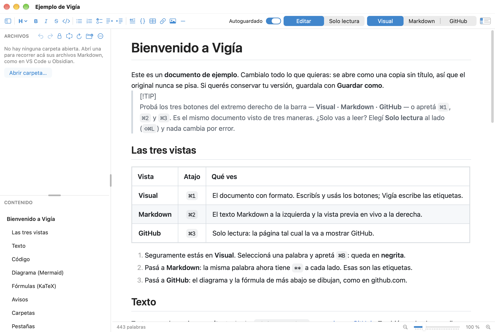
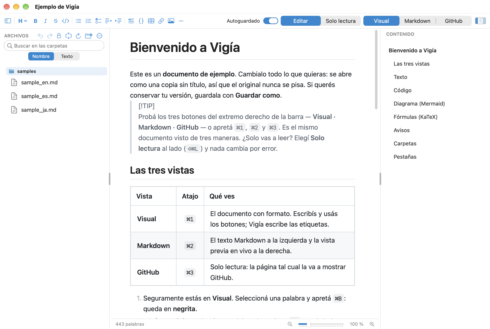
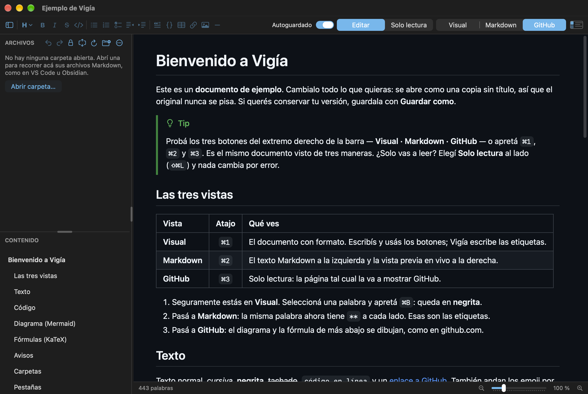

<p align="center"></p>

<h1 align="center">Vigía</h1>
<p align="center"><b>Escribí Markdown en forma visual. Miralo como en GitHub.</b></p>

Gabriel Castiglia · 27 de noviembre de 2026 · versión 3.5.3 · GPL-2.0-only

Hasta la versión 2.2.1 se llamaba Gryphmark: al instalar Vigía se quita, y su configuración, sus instancias
dedicadas y sus borradores de recuperación pasan solos la primera vez que Vigía arranca.

[English](README.md) · Español

Versión para Windows: <https://github.com/Gabriel-Castiglia/vigia-windows>

Manual en PDF: [`docs/Vigia-manual-es.pdf`](docs/Vigia-manual-es.pdf)

> Solo para macOS 15 o posterior en Apple silicon (arm64). No hay versión para Mac con procesador Intel.

Vigía es un visor y editor de Markdown para la Mac. Das formato con botones (títulos, negrita, listas,
tablas, código) y Vigía escribe las etiquetas de Markdown por vos; la vista GitHub muestra el documento tal
cual lo muestra GitHub, en claro u oscuro. La interfaz está en español, inglés y japonés ([日本語](README.ja.md)).

## Recarga en vivo

Cuando otro programa cambia el archivo abierto, por ejemplo un asistente de IA que lo edita, Vigía muestra el
texto nuevo enseguida y te deja donde estabas leyendo, en cualquiera de las vistas; si estabas leyendo el final, seguís lo que se agrega ahí. Sigue las distintas formas de
guardar: escribir encima del archivo, escribir uno nuevo y renombrarlo encima del viejo, o borrarlo y volver a
escribirlo. Sigue funcionando con la ventana detrás de otras apps, así que el cambio ya está cuando mirás. Lo que
cambió queda marcado en verde unos segundos: los párrafos nuevos o reescritos, y en una lista o una tabla solo el
punto o la fila que se agregó. Si tenés cambios sin guardar, pregunta antes de reemplazarlos.



## Requisitos

- macOS 15 o posterior en una Mac con Apple silicon. Probado en macOS 27.2.
- Para compilarlo: las Command Line Tools de Apple (`xcode-select --install`). Xcode no hace falta.

## Instalación

Bajá `Vigia-<versión>.pkg` de la [página de versiones](https://github.com/Gabriel-Castiglia/vigia/releases/latest)
y abrilo. El instalador está en español, inglés o japonés, según el idioma de la Mac. Pone `Vigia.app` en
`/Applications` y, si había una copia abierta, la cierra antes; instalar un paquete más nuevo conserva la
configuración.

El paquete no está firmado con un Developer ID de Apple, así que la primera vez macOS no lo abre («Apple no
pudo verificar…»). Abrí Configuración del Sistema → Privacidad y seguridad, bajá hasta el aviso sobre
`Vigia-<versión>.pkg`, hacé clic en Abrir igualmente y confirmá. Con el archivo `SHA256SUMS.txt` de cada
versión podés comprobar la descarga antes:

```
shasum -a 256 Vigia-3.2.0.pkg
```

Vigía puede abrir archivos Markdown desde el Finder (clic derecho → Abrir con → Vigía) sin quitárselos a
la app que los abre hoy. Para desinstalarlo, cerrá Vigía, arrastrá `/Applications/Vigia.app` a la
papelera y, si querés borrar también la configuración, corré `defaults delete io.github.gabriel-castiglia.vigia`.

## Uso

- Tres vistas del mismo documento (⌘1, ⌘2, ⌘3): Visual, el documento con formato que editás con los botones;
  Markdown, el código con la vista previa en vivo al lado; GitHub, de solo lectura, tal cual lo va a mostrar
  github.com.
- Pestañas: cada archivo se abre en su propia pestaña, que conserva su historial de deshacer, el cursor y el lugar
  de lectura mientras se ve otra. Abrir un archivo muestra la pestaña que ya lo tiene, o lo abre en una pestaña nueva
  al lado de la que se ve; una pestaña sin título en la que nadie escribió, o el ejemplo tal como vino, toma el archivo
  en su lugar. Un clic en el panel de archivos, un enlace a otro archivo Markdown y los archivos soltados en la
  ventana abren de la misma forma, y varios archivos elegidos juntos en Archivo → Abrir… abren una pestaña cada uno.
  ⌘T abre una pestaña sin título y ⌘W cierra una, preguntando por sus cambios sin guardar; ⌃⇥ y ⌃⇧⇥ cambian de
  pestaña, y ⇧⌘T (Archivo → Reabrir la pestaña cerrada) trae la última que se cerró. Son las pestañas de macOS: una
  pestaña se arrastra a lo largo de la barra para cambiarla de lugar, o fuera de la ventana para darle una ventana
  propia; el menú Ventana mueve una pestaña a una ventana nueva, junta todas las ventanas y muestra todas las
  pestañas. ⌘N sigue abriendo una ventana nueva, igual que clic derecho → *Abrir en otra ventana* en el panel de
  archivos. Con Archivo → Reabrir las pestañas al iniciar encendido (viene apagado), el próximo arranque vuelve a abrir
  los mismos archivos con la misma pestaña adelante. La lista se escribe a medida que cambian las pestañas, así que
  sobrevive a un cierre inesperado; los documentos sin título no se guardan, y un archivo que ya no está se deja
  afuera. Una actualización que se instala sola vuelve a abrir todas las pestañas.
- Pestaña de vista previa: un clic en un archivo del panel Archivos (o en Favoritos o Recientes) lo muestra en una
  pestaña de paso, con el nombre en cursiva, que el clic siguiente reutiliza, así recorrer una carpeta no deja una
  pestaña por archivo. Escribir en ella, guardarla con un nombre o un doble clic en el archivo la conserva. Archivo →
  Pestaña de vista previa para los archivos del panel la desactiva. Un archivo abierto desde Favoritos deja las
  carpetas del panel como estaban.
- Editar o Solo lectura (⇧⌘L): solo lectura bloquea el texto para que nada cambie por error; igual podés
  seleccionar, copiar, buscar y cambiar de vista.
- La barra y el menú Formato: títulos, negrita, cursiva, tachado, código en línea, listas, listas de tareas,
  sangría, cita, bloque de código, tabla, enlace, imagen y línea horizontal.
- Avisos de GitHub, diagramas Mermaid, fórmulas (KaTeX), notas al pie y emojis en la vista GitHub.
- Los paneles (⇧⌘E): Archivos, con los archivos Markdown de una o más carpetas (Archivo → Abrir carpeta…), y
  Contenido, con los títulos del documento abierto; clic en un título para ir a él. El archivo abierto se resalta y
  sus carpetas se abren. Cada panel va a la izquierda o a la derecha del texto, y dos paneles del mismo lado van uno
  arriba del otro o lado a lado. El botón de disposición, en el extremo derecho de la barra de herramientas, se
  dibuja como la disposición actual; un clic muestra las seis disposiciones dibujadas, un interruptor por panel y
  un botón que los intercambia. Ver → Disposición tiene las mismas seis. Un panel también se arrastra por su título
  (ARCHIVOS o CONTENIDO) hasta un borde de la ventana: mientras se mueve, el lugar que va a ocupar se ilumina con su
  nombre, y Esc deja todo como estaba. Los divisores se arrastran para cambiar el ancho de cada lado y el lugar de
  cada panel; cada disposición recuerda su ancho, y cada ventana los recuerda. Los divisores tienen una agarradera
  visible que toma el color de acento bajo el puntero; un doble clic devuelve el tamaño de siempre. Ver → Ancho del
  texto ensancha la columna de las vistas Visual y GitHub (Normal es la de GitHub, 980 px).
- Buscar en las carpetas (⇧⌘F, o Edición → Buscar en carpetas): el campo de arriba del árbol busca un archivo por
  su nombre o palabras dentro de todos los archivos Markdown de las carpetas abiertas, sin distinguir mayúsculas ni
  tildes. Los resultados vienen agrupados por archivo, cada línea con su número y la coincidencia en negrita; ↓ y ↑
  los recorren, y Return o un clic abren el archivo en esa misma coincidencia, con la barra de búsqueda mostrándola,
  también en las vistas Visual y GitHub, que ocultan las direcciones de los enlaces y las etiquetas del texto. Esc o
  el campo vacío devuelven el árbol.
- Favoritos: la estrella a la derecha de una fila (tenue bajo el puntero, dorada si está puesta), clic derecho →
  *Agregar a favoritos*, o Archivo → Favorito para el archivo abierto. Los archivos y carpetas favoritos forman una
  sola lista para todas las carpetas, el primer bloque del panel Archivos, primero las carpetas y cada archivo con su
  carpeta en gris; una carpeta favorita se abre como un árbol. Para reordenarlos se arrastra un favorito sobre otro,
  o clic derecho: Subir, Bajar, Ordenar A → Z, Quitar los que ya no existen, Vaciar la lista. Un favorito al que se
  le cambia el nombre o se mueve desde el panel sigue a su archivo.
- Un bloque RECIENTES con los últimos archivos abiertos, debajo de los favoritos. Viene apagado: Ver → Archivos
  recientes en el panel, o el menú ⋯ del panel.
- Actualizaciones que se instalan solas: Ayuda → Buscar actualizaciones, y un chequeo diario. Si hay una versión más
  nueva, una sola pregunta: Actualizar ahora, Ver novedades o Más tarde. El paquete se descarga y se compara con el
  `SHA256SUMS.txt` de la versión (si no coincide se borra sin abrirlo), y la app que trae tiene que tener el mismo
  identificador, la versión anunciada y la misma firma; Vigía se cierra como cuando lo cerrás vos (pregunta por
  los cambios sin guardar), la app nueva ocupa el lugar de la vieja y se abre. Las instancias dedicadas toman la
  versión nueva cuando se abre la app principal. Una copia que no es `/Applications/Vigia.app` recibe la página
  de descarga; una instalada por otro usuario abre el paquete ya comprobado en el Instalador.
- Cambiar de nombre y mover archivos: clic derecho en un archivo o una carpeta del panel → *Cambiar nombre…*. Para
  mover, un clic en el candado de la cabecera del panel desbloquea el árbol, y los archivos y carpetas se arrastran
  sobre una carpeta; otro clic lo vuelve a bloquear. Las dos flechas de la cabecera deshacen y rehacen cada cambio de
  nombre y cada movimiento. Todo pasa en el disco; el documento abierto sigue a su archivo, y antes se guarda si
  tenía cambios.
- Archivos y carpetas nuevos, y eliminar, también con el árbol desbloqueado: los dos primeros botones de la barra, y
  clic derecho en una carpeta → *Nuevo archivo Markdown…* o *Nueva carpeta…*, los crean en el disco en el momento,
  con un nombre libre propuesto (*Documento nuevo.md*, *Documento nuevo 2.md*…). Van a la carpeta del clic derecho, o
  a la última carpeta creada, o a la carpeta del documento abierto, o a la primera carpeta abierta; sin carpetas
  abiertas, a `Documentos/Vigia`, que se crea y se suma al panel. Un archivo sin extensión de Markdown recibe `.md`,
  empieza con su nombre como título y se abre en el momento. Nunca se escribe encima: un nombre ya usado se rechaza.
  Clic derecho → *Eliminar* manda un archivo o una carpeta a la Papelera, de donde se puede recuperar, después de una
  pregunta que se puede silenciar para esa ventana; donde no hay Papelera (una carpeta de red) vuelve a preguntar,
  siempre, antes de borrar del todo. Las pestañas de lo eliminado se cierran, y sale de Favoritos y de Recientes.
- Imágenes: al lado del documento o en otra carpeta (`../img/a.png`), con una ruta absoluta o una
  dirección `file:`, con espacios en la ruta, y como `![[imagen.png]]` o `![[imagen.png|300]]`, que se buscan en
  las carpetas abiertas. `` fija el ancho. Una imagen que no se encuentra muestra su nombre en un
  recuadro punteado; un clic en una imagen la abre en Vista Previa.
- Las tablas entran en la columna: una ruta o un código largo dentro de una celda se corta donde hace falta, en vez
  de mandar la tabla detrás de una barra de desplazamiento.
- Las propiedades al principio de un archivo (front matter, entre dos líneas `---`) se ven como un recuadro gris
  plegado en la vista Visual y como una tabla en la vista GitHub, y se guardan tal como estaban escritas.
- Las carpetas del panel de archivos: cada una tiene su color (tonos del color del tema, multicolor o ninguno, o uno
  elegido a mano) y se puede fijar arriba, subir, bajar o cerrar (clic derecho en su nombre). El botón ⋯ las ordena
  (orden de apertura, por nombre o modificadas recientemente primero) y define qué se abre al iniciar: las carpetas de
  la última sesión, ninguna o solo las fijadas (también Archivo → Carpetas al iniciar). El botón de dos flechas de la
  cabecera del panel contrae todas las carpetas mientras haya alguna abierta, y las expande todas, en todos los
  niveles, cuando están todas cerradas; su ícono y su ayuda dicen cuál de las dos hace, y el menú ⋯ tiene la misma
  orden. Expandir se detiene en 1.500 carpetas, para que un árbol del tamaño de un disco entero no trabe la ventana.
- Menú Idioma: español, inglés o japonés, con el cambio en el acto en todas las ventanas, menús del editor incluidos.
  El primer arranque sigue el idioma de la Mac. Con un texto en japonés la línea de estado cuenta las palabras con el
  separador de palabras del sistema, porque el japonés no deja espacios entre ellas, y Ayuda → Guía de Markdown abre
  la página de GitHub en el idioma de la interfaz.
- Convertir a TXT: clic derecho en un archivo del panel de archivos. Se escribe un .txt al lado, como se lee el
  documento en la vista GitHub (títulos, listas, tablas y enlaces en texto plano); el archivo Markdown no cambia.
- Buscar y reemplazar (⌘F, ⌥⌘F, ⌘G), zoom (⌘+, ⌘−, ⌘0, o el deslizador de la línea de estado), exportar a una página HTML
  autónoma (⌘E), imprimir o guardar como PDF (⌘P).
- Al guardar se respeta tu formato: los bloques que no tocaste conservan su Markdown original, de una línea
  editada cambia solo lo que tocaste, y el archivo conserva sus fines de línea (LF o CRLF) y su marca de orden
  de bytes. El texto nuevo llega al disco antes de ocupar el lugar del viejo, así un cuelgue o un corte de luz deja
  uno u otro; un enlace simbólico sigue siendo enlace (se escribe el archivo al que apunta), el archivo conserva sus
  permisos y sus etiquetas de Finder, y un archivo de solo lectura se rechaza en vez de reemplazarse.
- Corrector ortográfico en varios idiomas a la vez, activado con inglés, español, español del Uruguay y japonés:
  una palabra está bien si alguno de los idiomas elegidos la conoce, así un texto que mezcla idiomas se revisa
  entero. Revisa el corrector de la Mac, palabra por palabra en cada idioma; Edición → Idiomas y diccionario del
  corrector… ofrece todos los idiomas que tiene macOS. El español del Uruguay es el español de la Mac más el voseo
  (*tenés*, *mirá*, *decíselo*), que el español de la Mac marca. Las palabras marcadas llevan una línea ondulada roja
  en las vistas Visual y Markdown; el código y las direcciones no se revisan, y el texto en japonés nunca se marca
  (no hay diccionario ortográfico de japonés). Con clic derecho en una palabra marcada aparecen las sugerencias,
  *Omitir (hasta salir de Vigía)* y *Agregar al diccionario* (queda en la configuración de este Vigía; el mismo
  diálogo muestra esas palabras, y al destildar una se saca). Edición → Corrector ortográfico lo activa o desactiva
  en todas las pestañas sin tocar el texto.
- Autoguardado, encendido de fábrica: un archivo con nombre se guarda solo un momento después de que dejás de
  escribir. El interruptor *Autoguardado* de la barra (también Archivo → Autoguardado) lo apaga, y entonces solo
  Guardar (⌘S) escribe el archivo. Nunca escribe encima de un cambio hecho por otro programa: Vigía pregunta
  antes, igual que sin autoguardado.
- Si Vigía se cierra sin guardar, al volver a abrirlo ofrece recuperar el texto.
- Los enlaces `[[nombre]]` de la vista GitHub abren el archivo Markdown de ese nombre en las carpetas abiertas,
  como en una wiki; el que no lleva a ningún archivo sale en rojo. Un documento que está dentro de una carpeta del
  panel de archivos puede enlazar a las otras carpetas del panel, con `../` como en el disco.
- Instancias dedicadas: clic derecho en un archivo o una carpeta del panel de archivos → *Abrir en una instancia
  dedicada*. Queda como una app propia en Aplicaciones de tu carpeta de inicio, con sus ajustes y el color de su
  ícono, y la podés dejar en el Dock. Desde la Terminal:
  `Vigia.app/Contents/MacOS/Vigia --make-instance "Notas" --accent red --folder ~/Notas --read-only --mode preview`.
- Hasta que abrís un archivo propio, Vigía arranca con el documento de ejemplo (Ayuda → Documento de ejemplo
  lo abre cuando quieras). En una ventana angosta, los botones de formato que no entran pasan al menú ⋯.
- Ver → Tema… (⌘,) elige claro, oscuro o como macOS, y uno de doce colores para el resaltado y el ícono del
  Dock; el celeste es el de fábrica. El ícono en el Finder y en Launchpad sigue celeste, porque cambiarlo rompería
  la firma de la app.






## Seguridad

Un documento no puede ejecutar nada. El HTML que trae un archivo Markdown se limpia con DOMPurify antes de que la
vista GitHub o una exportación lo muestren. Los enlaces solo abren páginas web, correo, otros archivos Markdown
(en Vigía), imágenes y PDF; un enlace a cualquier otro archivo, como un programa o un script, solo lo muestra
en el Finder. La página del editor no llega a nada más que sus propios archivos, la carpeta del documento
abierto (o, si el documento está dentro de una carpeta del panel de archivos, las carpetas del panel) y las imágenes.

## Compilar

```
git clone https://github.com/Gabriel-Castiglia/vigia.git
cd vigia
scripts/compilar.sh          # build/Vigia.app
scripts/paquete.sh           # build/Vigia-<versión>.pkg
build/Vigia.app/Contents/MacOS/Vigia --self-test
```

`compilar.sh` firma la app con un certificado propio guardado en su propio llavero, que crea la primera vez,
para que macOS vea la misma app de una compilación a otra y no vuelva a pedir acceso a tus carpetas.
`FIRMA=adhoc scripts/compilar.sh` la firma sin ese certificado, para una prueba rápida. La versión se escribe
solo en `scripts/compilar.sh`.

La autoprueba corre en una ventana real con la página real, sin que se vea: la ventana es transparente, no recibe
clics ni pasa al frente, y la app no muestra ícono en el Dock (`--visible` la muestra, y además arrastra los
divisores de la barra lateral). Revisa el ejemplo, el cambio de tamaño (en su tamaño mínimo
la ventana no corta nada), el tema oscuro con todo el texto legible, un diagrama Mermaid, un documento hostil (no
puede correr ningún script), las reglas de los enlaces, guardar byte por byte con BOM y CRLF, la recarga en vivo
al reemplazar, borrar y volver a crear, escribir y guardar muchas veces seguidas, los cambios sin guardar
conservados, y la exportación a HTML.

La página del editor (`web/`) es la de la versión para Windows. Sus bibliotecas (`web/lib`) se arman con esbuild
desde `_npm/` con `scripts/web.sh`, que necesita Node.js; el paquete del repositorio se hizo así, con las
versiones exactas de `_npm/package-lock.json`. `scripts/manual.sh` hace los manuales PDF a partir de los dos
README, y `scripts/capturas.sh` las imágenes de `docs/img`. El ícono sale de `assets/icon.svg`, en sus doce
colores, con la herramienta de íconos del autor.

Las versiones de las herramientas con que se compiló y probó Vigía 3.1.0 están en la tabla del
[README en inglés](README.md#building-from-source).

## Estructura

| Carpeta | Contenido |
|---|---|
| `Sources/` | La app (Swift, AppKit, SwiftUI y WebKit) |
| `web/` | La página del editor y sus bibliotecas, compartidas con la versión para Windows |
| `_npm/` | Las dependencias web y la entrada de esbuild |
| `samples/` | El documento de ejemplo, en español, inglés y japonés |
| `assets/`, `icono/` | El ícono del faro y sus doce colores |
| `instalador/` | Las páginas y el script del paquete instalador |
| `scripts/` | Compilar, empaquetar, paquete web, manuales e imágenes |
| `tools/` | Dibujo del ícono |
| `docs/` | Manuales PDF e imágenes |

## Licencia y créditos

Copyright (C) 2026 Gabriel Castiglia. Vigía es software libre bajo la GNU General Public License, versión 2
únicamente (GPL-2.0-only); ver [`LICENSE`](LICENSE). Se distribuye sin ninguna garantía.

| Componente | Licencia |
|---|---|
| TOAST UI Editor, ProseMirror, marked (+ extensiones alert, footnote, katex), github-markdown-css, Mermaid, KaTeX, gemoji | MIT |
| highlight.js, jsdiff | BSD-3-Clause |
| DOMPurify | MPL-2.0 (usado bajo la opción MPL-2.0 de su doble licencia MPL-2.0 / Apache-2.0) |
| Ícono: un faro dibujado para Vigía (2026) | GPL-2.0-only, como el resto |
