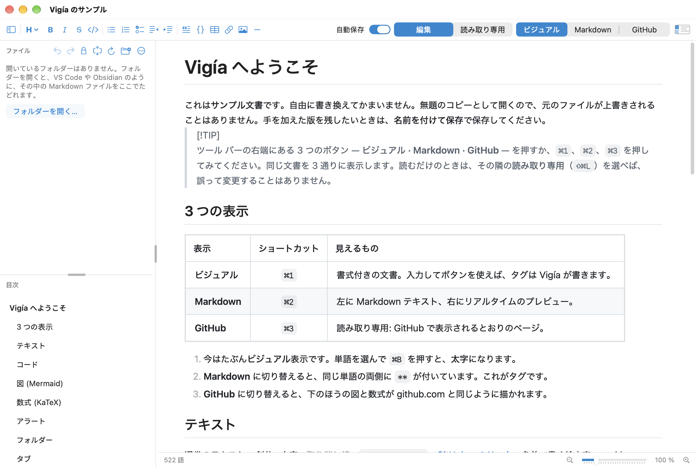
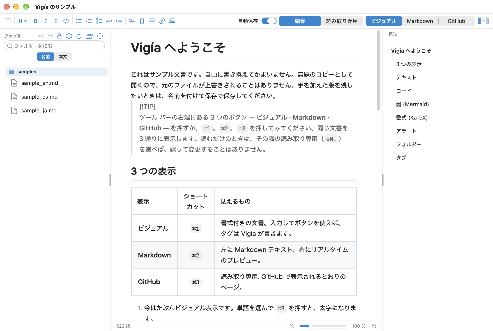
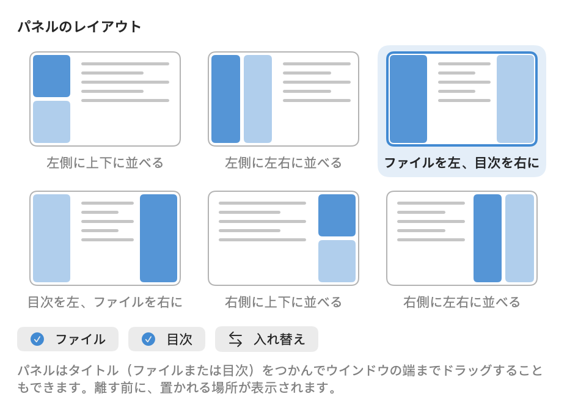
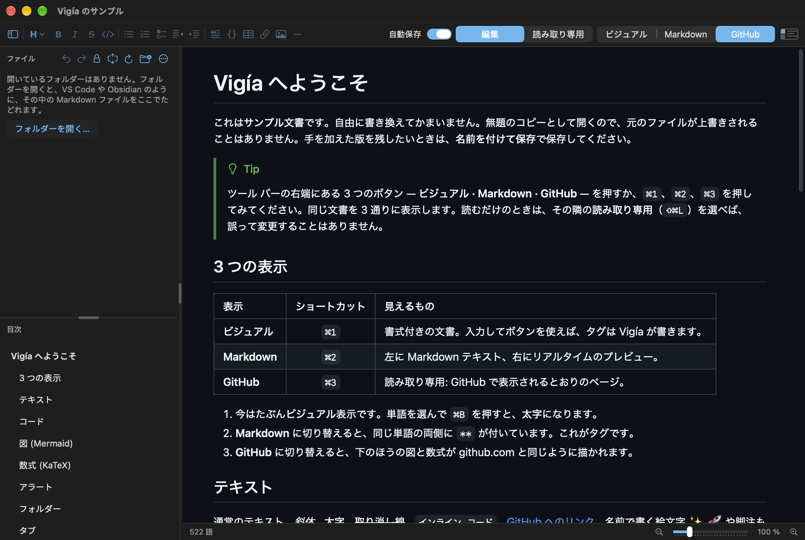
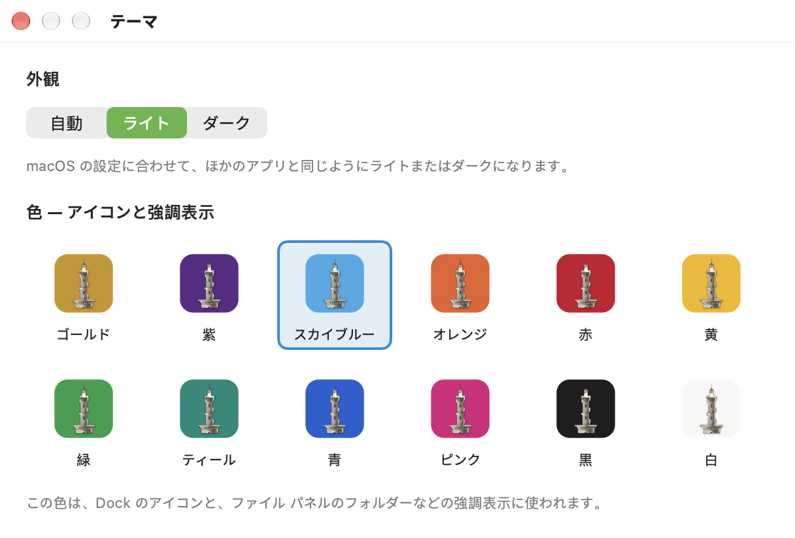

<p align="center"></p>

<h1 align="center">Vigía</h1>
<p align="center"><b>Markdown をビジュアルに書いて、GitHub と同じ見た目で確認。</b></p>

Gabriel Castiglia · 2026年11月25日 · バージョン 3.3.1 · GPL-2.0-only

[English](README.md) · [Español](README.es.md) · 日本語

Windows 版: <https://github.com/Gabriel-Castiglia/vigia-windows>

PDF マニュアル: [`docs/Vigia-manual-ja.pdf`](docs/Vigia-manual-ja.pdf)

> Apple シリコン (arm64) 搭載の macOS 15 以降専用です。Intel プロセッサーの Mac 用のビルドはありません。

Vigía は Mac 用の Markdown ビューアー兼エディターです。見出し、太字、リスト、表、コードなどの書式をボタンで付けると、
Markdown のタグは Vigía が書きます。GitHub 表示では、文書が GitHub とまったく同じように、ライトまたはダークのテーマで
表示されます。画面は英語、スペイン語、日本語です。

## リアルタイムの再読み込み

AI アシスタントなどほかのプログラムが開いているファイルを変更すると、Vigía は新しいテキストをすぐに表示し、どの表示でも
読んでいた位置はそのままです。末尾を読んでいるときは、追加される部分についていきます。上書き保存、新しいファイルに書いて
から古いファイルの上に名前を変える保存、削除してから書き直す保存のどれにも追従します。ウインドウがほかのアプリの後ろに
あっても動き続けるので、見たときには変更がもう反映されています。変わった部分（新しい段落や書き直された段落、リストや表に
追加された項目や行）は数秒間緑色で示します。保存していない変更があるときは、置き換える前に確認します。



## 動作環境

- Apple シリコン搭載の Mac で macOS 15 以降。macOS 27.2 でテスト済み。
- ソースからビルドするには Apple の Command Line Tools（`xcode-select --install`）が必要です。Xcode は不要です。

## インストール

[リリース ページ](https://github.com/Gabriel-Castiglia/vigia/releases/latest) から `Vigia-<バージョン>.pkg` を
ダウンロードして開きます。インストーラーは Mac の言語に合わせて英語、スペイン語、日本語で表示されます。`Vigia.app` を
`/Applications` に入れ、開いているコピーがあれば先に閉じます。新しいパッケージをインストールしても設定は残ります。

パッケージは Apple の Developer ID で署名していないため、最初は macOS が開くのを拒否します（「Apple は検証できません
でした…」）。システム設定 → プライバシーとセキュリティ を開き、`Vigia-<バージョン>.pkg` についてのメッセージまで
スクロールして［このまま開く］をクリックし、確認します。各リリースの `SHA256SUMS.txt` で、ダウンロードしたファイルを
先に確かめられます:

```
shasum -a 256 Vigia-3.2.0.pkg
```

Finder から Markdown ファイルを Vigía で開けます（右クリック → このアプリケーションで開く → Vigía）。今そのファイルを
開いているアプリから関連付けを奪うことはありません。アンインストールするには、Vigía を終了して `/Applications/Vigia.app`
をゴミ箱にドラッグします。設定も消すには `defaults delete io.github.gabriel-castiglia.vigia` を実行します。

## 使い方

- 同じ文書の 3 つの表示（⌘1、⌘2、⌘3）: ボタンで編集する書式付きの文書「ビジュアル」、リアルタイムのプレビュー付きの
  ソース「Markdown」、github.com での見え方どおりの読み取り専用「GitHub」。
- タブ: ファイルはそれぞれ自分のタブで開き、別のタブを表示している間も、元に戻す履歴、カーソル、スクロール位置を
  保ちます。ファイルを開くと、そのファイルのタブがあればそれを表示し、なければ表示中のタブの隣の新しいタブで開きます。
  誰も入力していない無題のタブや、開いたままのサンプルは、そのタブ自体にファイルを開きます。ファイル パネルのクリック、
  ほかの Markdown ファイルへのリンク、ウインドウにドロップしたファイルも同じです。*ファイル → 開く…* でまとめて選んだ
  ファイルは 1 つずつタブで開きます。⌘T で無題のタブを開き、⌘W で閉じます（保存していない変更があれば確認します）。
  ⌃⇥ と ⌃⇧⇥ でタブを切り替え、⇧⌘T（*ファイル → 閉じたタブを開き直す*）で最後に閉じたタブを開き直します。macOS の
  タブなので、タブ バーに沿ってドラッグすると並べ替えられ、ウインドウの外へドラッグすると別のウインドウになります。
  *ウインドウ* メニューでタブを新規ウインドウに移動したり、すべてのウインドウを結合したり、すべてのタブを表示したり
  できます。⌘N は今までどおり新規ウインドウを開きます。*ファイル → 起動時にタブを復元* をオンにすると（既定はオフ）、
  次回の起動時に同じファイルが同じタブを前にして開きます。一覧はタブが変わるたびに書き込まれるので、異常終了にも
  耐えます。無題の文書は残らず、そのときにないファイルは除かれます。自動でインストールされる更新は、すべてのタブを
  開き直します。
- プレビュー タブ: ファイル パネル（またはお気に入り、最近使った項目）でファイルをクリックすると、名前が斜体の一時的なタブに
  表示され、次のクリックで同じタブが使われるので、フォルダーを見て回ってもファイルごとにタブが増えません。入力する、名前を
  付けて保存する、ファイルをダブルクリックするとタブが残ります。*ファイル → パネルのファイルをプレビュー タブで開く* で
  オフにできます。お気に入りから開いたファイルでは、パネルのフォルダーはそのままです。
- 編集 / 読み取り専用（⇧⌘L）: 読み取り専用にするとテキストがロックされ、誤って変わることはありません。選択、コピー、
  検索、表示の切り替えはできます。
- ツール バーと *書式* メニュー: 見出し、太字、斜体、取り消し線、インライン コード、リスト、タスク リスト、インデント、
  引用、コード ブロック、表、リンク、画像、水平線。
- GitHub 表示では GitHub のアラート、Mermaid の図、数式（KaTeX）、脚注、絵文字を表示します。
- パネル（⇧⌘E）: 1 つ以上のフォルダーの Markdown ファイルを表示する「ファイル」（*ファイル → フォルダーを開く…*）と、
  開いている文書の見出しを表示する「目次」。見出しをクリックするとそこへ移動します。開いているファイルは強調され、
  そのフォルダーが開きます。パネルは本文の左右どちらにも置け、同じ側の 2 つは上下にも左右にも並べられます。ツール バー
  右端のレイアウト ボタン（または *表示 → レイアウト*）で 6 つのレイアウトから選ぶか、パネルのタイトル（ファイルまたは
  目次）をウインドウの端までドラッグします。区切り線をドラッグすると幅が変わり、ダブルクリックで元の大きさに戻ります。
  *表示 → 本文の幅* で、ビジュアル表示と GitHub 表示の列を広げられます（「標準」は GitHub と同じ 980 px）。
- ファイル パネルのフォルダー: それぞれに色（テーマの色の濃淡、多色、なし、または手で選んだ色）があり、先頭への固定、
  上下への移動、閉じる操作ができます（名前を右クリック）。⋯ ボタンで並べ方（開いた順、名前順、最近変更した順）と、起動時に
  開くもの（前回のフォルダー、なし、固定したものだけ）を選びます。ヘッダーの 2 つの矢印のボタンは、開いているフォルダーが
  あればすべて折りたたみ、すべて閉じているときはすべての階層を展開します。アイコンとヒントでどちらになるかがわかり、⋯
  メニューにも同じ項目があります。展開は 1,500 フォルダーで止まるので、ディスク全体のような大きなツリーでもウインドウが
  固まりません。
- フォルダー内を検索（⇧⌘F）: ツリーの上の欄で、名前でファイルを探すか、開いているフォルダーのすべての Markdown ファイルの
  本文から語句を探します。結果はファイルごとに行番号付きで並び、クリックすると一致箇所を開きます。
- お気に入り: 行の右の星で、開いているすべてのフォルダーに共通の一覧に加わり、ファイル パネルの先頭に表示されます
  （ドラッグで並べ替え）。その下に任意の「最近使ったファイル」ブロック（*表示 → パネルに最近使ったファイル*）。
- ファイルとフォルダーの名前の変更と移動: ファイル パネルで右クリック → *名前の変更…*。移動するには、ヘッダーの錠前を
  開けてドラッグします。ヘッダーの 2 つの矢印で元に戻す / やり直しができ、開いている文書はファイルについていきます。
- 画像: 文書の隣や別のフォルダー（`../img/a.png`）、絶対パスや `file:` アドレス、`![[picture.png|300]]`（開いている
  フォルダーから探します）。見つからない画像は名前を点線の枠で示し、クリックするとプレビューで開きます。
- ファイル先頭のプロパティ（front matter）は、ビジュアル表示では折りたたんだ灰色の枠、GitHub 表示では表になり、書かれた
  とおりに保存されます。
- TXT に変換: ファイル パネルでファイルを右クリック。GitHub 表示での見え方どおりの .txt を隣に書き出し、Markdown
  ファイルは変えません。
- 検索と置換（⌘F、⌥⌘F、⌘G）、ズーム（⌘+、⌘−、⌘0、またはステータス バーのスライダー）、自己完結した
  HTML へのエクスポート（⌘E）、印刷 / PDF として保存（⌘P）。
- 書式はそのまま: 触れていないブロックは元の Markdown のまま、編集した行も変更した部分以外はそのままで、改行コード
  （LF / CRLF）と BOM も保たれます。新しいテキストはディスクに書き込まれてから古いファイルと入れ替わるので、クラッシュや
  停電があっても新旧どちらかが残ります。シンボリック リンクはリンクのまま（指す先のファイルに書き込みます）、ファイルの
  アクセス権と Finder のタグも保たれ、読み出し専用のファイルは置き換えずに保存を断ります。
- 複数の言語を同時にチェックするスペル チェック。最初から英語、スペイン語、ウルグアイのスペイン語、日本語でオンです。
  どれか 1 つの言語が知っている単語は正しいとみなすので、複数の言語が混ざった文章もまとめてチェックできます。チェックは
  Mac 自身のスペル チェッカーで言語ごとに行い、*編集 → スペル チェックの言語と辞書…* では macOS にあるすべての言語を
  選べます。ウルグアイのスペイン語は、Mac のスペイン語に voseo（*tenés*、*mirá*、*decíselo*）を加えたものです（Mac の
  スペイン語は voseo をマークします）。マークされた単語には、ビジュアル表示と Markdown 表示で赤い波線が付きます。コードと
  アドレスはチェックせず、日本語の文字はマークしません（日本語のスペル辞書はありません）。マークされた単語を右クリックすると、
  候補、*無視 (Vigía を終了するまで)*、*辞書に追加*（この Vigía の設定に保存。同じダイアログに一覧があり、チェックを外すと
  削除されます）が出ます。*編集 → スペル チェック* で、テキストに触れずにすべてのタブでオン/オフできます。
- 自動保存（既定でオン）: 名前のあるファイルは、入力が止まって少しすると自動で保存されます。ツール バーの *自動保存*
  スイッチ（*ファイル → 自動保存* でも可）でオフにでき、そのときは保存（⌘S）したときだけ書き込みます。ほかのプログラムが
  加えた変更を上書きすることはなく、その前に確認します。
- Vigía が保存せずに終了したときは、次回の起動時に保存されていないテキストの復元を提案します。
- GitHub 表示の `[[名前]]` リンクは、wiki のように、開いているフォルダーにあるその名前の Markdown ファイルを開きます
  （見つからないものは赤）。
- 専用インスタンス: ファイル パネルでファイルかフォルダーを右クリック → *専用インスタンスで開く*。ホーム フォルダーの
  ［アプリケーション］に、独自の設定とアイコンの色を持つ別のアプリとして作られ、Dock に置いておけます。
- *言語* メニュー: 英語、スペイン語、日本語。エディター自身のメニューも含めて、すべてのウインドウがすぐに切り替わります。
  最初の起動は Mac の言語に合わせます。日本語の文章は単語の間に空白がないので、ステータス バーはシステムの単語区切りで
  単語を数えます。*ヘルプ → GitHub の Markdown ガイド* は画面の言語の GitHub のページを開きます。
- *表示 → テーマ…*（⌘,）でライト、ダーク、macOS に合わせるを選び、強調表示と Dock のアイコンの色を 12 色から選びます。
  既定はスカイブルーです。Finder と Launchpad のアイコンはスカイブルーのままです（変えるとアプリの署名が壊れるため）。
- 自分のファイルを開くまでは、サンプル文書で起動します（*ヘルプ → サンプル文書* でいつでも開けます）。









## 安全性

文書内のリンクで開くのは、Web ページ、メール、ほかの Markdown ファイル、画像、PDF だけです。それ以外のファイルへの
リンクは、実行せずに Finder で表示します。文書のスクリプトは動きません。自動更新は、リリースの `SHA256SUMS.txt` と
照合し、同じ識別子と署名のアプリだけをインストールします。

ビルドの手順とプロジェクトの構成は、[英語の README](README.md) を参照してください。

## ライセンスとクレジット

Copyright (C) 2026 Gabriel Castiglia. Vigía は GNU General Public License バージョン 2（GPL-2.0-only）の
フリー ソフトウェアで、無保証です。全文は [LICENSE](LICENSE) にあります。アイコンは Debenne の灯台の設計図（1815 年ごろ、
The Met、CC0）の灯台です。使っているライブラリとそのライセンスは、[英語の README](README.md) に一覧があります。
