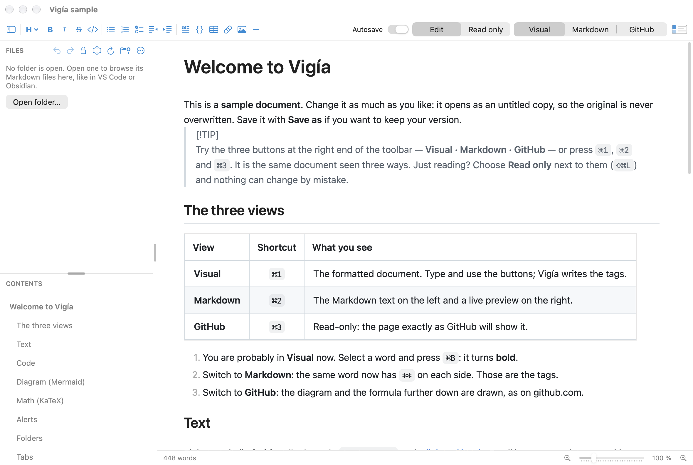
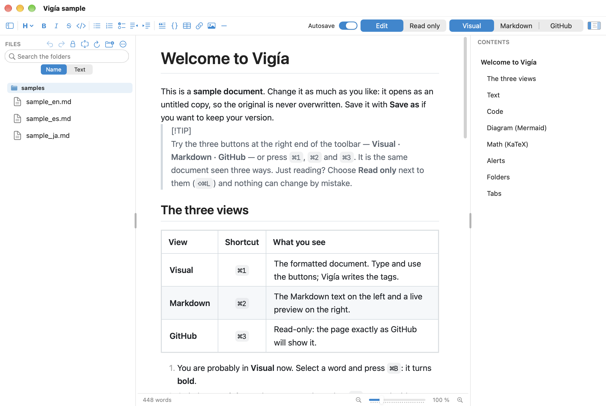
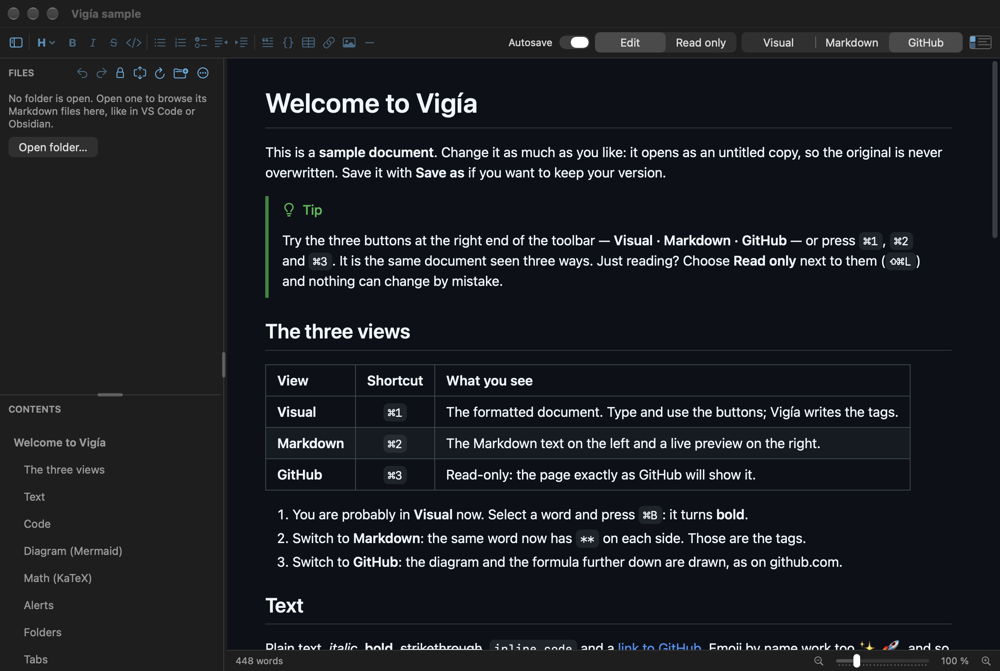

<p align="center"></p>

<h1 align="center">Vigía</h1>
<p align="center"><b>Write Markdown visually. See it like GitHub.</b></p>

Gabriel Castiglia · November 27, 2026 · version 3.5.3 · GPL-2.0-only

Until version 2.2.1 it was called Gryphmark: installing Vigía removes it, and its settings, dedicated instances
and recovery drafts come over the first time Vigía starts.

English · [Español](README.es.md)

Windows version: <https://github.com/Gabriel-Castiglia/vigia-windows>

PDF manual: [`docs/Vigia-manual-en.pdf`](docs/Vigia-manual-en.pdf)

> macOS 15 or later on Apple silicon (arm64) only. There is no build for Macs with an Intel processor.

Vigía is a Markdown viewer and editor for the Mac. You format with buttons (headings, bold, lists, tables,
code) and Vigía writes the Markdown tags for you; the GitHub view shows the document exactly as GitHub does,
in light or dark. The interface is in English, Spanish and Japanese ([日本語](README.ja.md)).

## Live reload

When another program changes the open file, such as an AI assistant editing it, Vigía shows the new text at
once and keeps you where you were reading, in every view; reading at the end, you follow what is added there. It follows the ways programs save: writing over the
file, writing a new file and renaming it over the old one, or deleting it and writing it again. It keeps running
while the window is behind other apps, so the change is already there when you look. What changed is marked in
green for a few seconds: new or rewritten paragraphs, and the single points or rows added to a list or a table. If
you have unsaved changes, Vigía asks before replacing them.



## Requirements

- macOS 15 or later on a Mac with Apple silicon. Tested on macOS 27.2.
- To build from source: Apple's Command Line Tools (`xcode-select --install`). Xcode is not needed.

## Installation

Download `Vigia-<version>.pkg` from the
[releases page](https://github.com/Gabriel-Castiglia/vigia/releases/latest) and open it. The installer speaks
English, Spanish or Japanese, following the language of the Mac. It puts `Vigia.app` in `/Applications`, closing a
running copy first; installing a newer package keeps the settings.

The package is not signed with an Apple Developer ID, so the first time macOS refuses to open it ("Apple
could not verify…"). Open System Settings → Privacy & Security, scroll to the message about
`Vigia-<version>.pkg`, click Open Anyway and confirm. The `SHA256SUMS.txt` file of each release lets you
check the download first:

```
shasum -a 256 Vigia-3.2.0.pkg
```

Vigía can open Markdown files from the Finder (right-click → Open With → Vigía) without taking them over
from the app that opens them now. To uninstall, quit Vigía, drag `/Applications/Vigia.app` to the Trash
and, to remove the settings too, run `defaults delete io.github.gabriel-castiglia.vigia`.

## Using it

- Three views of the same document (⌘1, ⌘2, ⌘3): Visual, the formatted document you edit with the buttons;
  Markdown, the source with a live preview beside it; GitHub, read only, as github.com will show it.
- Tabs: each file opens in a tab of its own, which keeps its undo history, cursor and scroll position while
  another one is shown. Opening a file shows the tab that already has it, or opens it in a new tab next to the shown
  one; an untitled tab nobody typed in, or the sample as it came, takes the file instead. A click in the Files panel,
  a link to another Markdown file and the files dropped on the window open the same way, and several files chosen
  together in File → Open… open a tab each. ⌘T opens an untitled tab and ⌘W closes one, asking about its unsaved
  changes; ⌃⇥ and ⌃⇧⇥ switch tabs, and ⇧⌘T (File → Reopen Closed Tab) brings back the last one closed. They are the
  tabs of macOS: drag one along the tab bar to reorder it, or out of the window to give it a window of its own; the
  Window menu moves a tab to a new window, merges all the windows and shows all the tabs. ⌘N still opens a new window,
  and right-click → *Open in new window* in the Files panel too. With File → Reopen Tabs at Start on (off by default),
  the next start opens the same files again with the same tab in front. The list is written as the tabs change, so
  it survives a crash; untitled documents are not kept, and a file that is gone by then is left out. An update that
  installs itself opens every tab again.
- Preview tab: a click on a file in the Files panel (or in Favourites or Recent) shows it in a passing tab, its name
  in italics, that the next click there reuses, so browsing a folder does not leave a tab per file. Typing in it,
  saving it under a name, or a double click on the file keeps it. File → Preview Tab for Files from the Panel turns
  it off. A file opened from Favourites leaves the folders of the panel as they were.
- Edit or Read only (⇧⌘L): read only locks the text so nothing changes by mistake; you can still select, copy,
  find and switch views.
- The toolbar and the Format menu: headings, bold, italic, strikethrough, inline code, lists, task lists,
  indent, quote, code block, table, link, picture and horizontal rule.
- GitHub alerts, Mermaid diagrams, math (KaTeX), footnotes and emoji in the GitHub view.
- The panes (⇧⌘E): Files, with the Markdown files of one or more folders (File → Open folder…), and Contents, with
  the headings of the open document; click a heading to go to it. The open file is highlighted and its folders
  open. Each pane goes to the left or to the right of the text, and two panes on one side sit one above the other
  or side by side. The layout button at the right end of the toolbar is drawn as the current layout; a click shows
  the six layouts drawn, a switch for each pane and a button that swaps them. View → Layout lists the same six.
  A pane can also be dragged by its title (FILES or CONTENTS) to an edge of the window: while it moves, the place
  it would take is lit and named, and Esc leaves everything as it was. Drag the dividers to change the width of
  each side and the room of each pane; each arrangement keeps its own width, and each window keeps them. The
  dividers have a visible handle that takes the accent colour under the pointer; a double click gives the usual
  size back. View → Text width widens the column of the Visual and GitHub views (Normal is GitHub's 980 px).
- Search in the folders (⇧⌘F, or Edit → Search in folders): the box above the tree looks for a file by its name
  or for words inside every Markdown file of the open folders, capitals and accents aside. Results come grouped by
  file, each line with its number and the match in bold; ↓ and ↑ move through them and Return or a click opens the
  file at that very match, with the find bar showing it, also in the Visual and GitHub views, which hide the link
  addresses and tags of the text. Esc or an empty box gives the tree back.
- Favourites: the star at the right of a row (faint under the pointer, golden when on), right-click → *Add to
  favourites*, or File → Favourite for the open file. Favourite files and folders make one list for every folder,
  the first block of the Files panel, folders first and each file with its folder in grey; a favourite folder opens
  like a tree. Drag a favourite onto another to reorder them, or right-click: Move up, Move down, Sort A → Z, Remove
  the ones that no longer exist, Empty the list. A favourite renamed or moved from the panel follows its file.
- A RECENT block with the last files opened, under the favourites. Off by default: View → Recent Files in the
  Panel, or the panel's ⋯ menu.
- Updates that install themselves: Help → Check for updates, and a check once a day. When there is a newer
  version, one question: Update now, What's new or Later. The package is downloaded and checked against the
  release's `SHA256SUMS.txt` (a file that does not match is deleted and never opened), and the app inside it for
  the same identifier, the announced version and the same signature; Vigía quits as when you quit it (it asks
  about unsaved changes), the new app takes the place of the old one and opens. The dedicated instances take the
  new version when the main app opens. A copy that is not `/Applications/Vigia.app` is offered the download
  page; one installed by another user opens the checked package in Installer.
- Renaming and moving files: right-click a file or folder in the Files panel → *Rename…*. To move, click the padlock
  in the panel header to unlock the tree and drag files and folders onto a folder; click it again to lock it. The
  two arrows of the header undo and redo each rename and move. All of it happens on disk; the open document follows
  its file, saved first if it had changes.
- New files and folders, and deleting, also with the tree unlocked: the first two buttons of the toolbar, and
  right-click on a folder → *New Markdown File…* or *New Folder…*, make them at once on disk, with a free name offered
  (*New document.md*, *New document 2.md*…). They go into the folder that was right-clicked, or the folder made last,
  or the folder of the open document, or the first open folder; with no folder open, into `Documents/Vigia`, which
  is made and added to the panel. A file without a Markdown extension gets `.md` and starts with its name as a
  heading, and opens at once. Nothing is written over: a name already taken is refused. Right-click → *Delete* moves
  a file or folder to the Trash, where it can be restored, after a question that can be silenced for that window;
  where there is no Trash (a network folder), it asks again, always, before deleting for good. The tabs of what is
  deleted close, and it leaves Favourites and Open recent.
- Pictures: beside the document or in another folder (`../img/a.png`), by an absolute path or a
  `file:` address, with spaces in the path, and as `![[picture.png]]` or `![[picture.png|300]]`, looked for in the
  open folders. `` sets the width. A picture that is not found shows its name in a dashed box; a
  click on a picture opens it in Preview.
- Tables fit the column: a long path or piece of code in a cell breaks where it has to instead of pushing the table
  behind a scrollbar.
- Properties at the top of a file (front matter, between two `---` lines) show as a grey folded box in the Visual
  view and as a table in the GitHub view, and are saved exactly as written.
- The folders of the Files panel: each one has its own colour (tones of the theme colour, multicolour or none, or one
  chosen by hand), and can be pinned to the top, moved up and down or closed (right-click its name). The ⋯ button
  orders them (order opened, by name or recently modified first) and sets what opens at start: the folders of the
  last session, none, or only the pinned ones (also File → Folders at start). The button of the panel header with
  two arrows collapses every folder while any is open, and expands them all, every level, when everything is closed;
  its icon and tooltip say which, and the ⋯ menu has the same command. Expanding stops after 1,500 folders, so a
  tree as big as a whole disk does not hold the window.
- Language menu: English, Spanish or Japanese, switched at once in every window, the editor's own menus included.
  The first start follows the language of the Mac. With a Japanese text the status line counts words with the
  system's word breaker, since Japanese has no spaces between them, and Help → Markdown guide opens GitHub's page in
  the language of the interface.
- Convert to TXT: right-click a file in the Files panel. A .txt is written next to it, as the document reads in the
  GitHub view (headings, lists, tables and links in plain text); the Markdown file is not changed.
- Find and replace (⌘F, ⌥⌘F, ⌘G), zoom (⌘+, ⌘−, ⌘0, or the slider of the status line), export to a self-contained HTML page (⌘E),
  print or save as PDF (⌘P).
- Saving keeps your formatting: blocks you did not touch keep their original Markdown, an edited line keeps all of
  itself but your change, and the file keeps its line endings (LF or CRLF) and its byte order mark. The new text
  reaches the disk before it takes the place of the old file, so a crash or a power cut leaves one or the other;
  a symbolic link stays a link (the file it points to is the one written), the file keeps its permissions and its
  Finder tags, and a read-only file is refused instead of replaced.
- Spell check in several languages at once, on by default with English, Spanish, the Spanish of Uruguay and
  Japanese: a word is right when any chosen language knows it, so a text that mixes languages is checked as a whole.
  The checking is the Mac's own, word by word in each language; Edit → Spell Check Languages and Dictionary… offers
  every language macOS has. The Spanish of Uruguay is the Mac's Spanish plus the voseo (*tenés*, *mirá*,
  *decíselo*), which the Mac's Spanish marks. Marked words get a red wavy line in the Visual and Markdown views;
  code and addresses are left out, and Japanese text is never marked (there is no Japanese spelling dictionary).
  Right-click a marked word for its suggestions, *Ignore (until Vigía quits)* and *Add to Dictionary* (kept in the
  settings of this Vigía; the same dialog lists those words, untick one to take it out). Edit → Spell check turns
  it on or off in every tab without touching the text.
- Autosave, on by default: a file with a name saves itself a moment after you stop typing. The *Autosave* switch
  in the toolbar (also File → Autosave) turns it off, and then only Save (⌘S) writes the file. It never writes over
  a change made by another program: Vigía asks first, as without autosave.
- If Vigía closes without saving, the next start offers the unsaved text back.
- `[[name]]` links in the GitHub view open the Markdown file of that name in the open folders, as in a wiki; one
  that matches no file is shown in red. A document inside a folder of the Files panel can link to the other
  folders of the panel, with `../` as on disk.
- Dedicated instances: right-click a file or a folder in the Files panel → *Open in a dedicated instance*. It
  becomes an app of its own in Applications in your home folder, with its own settings and icon colour, that
  you can keep in the Dock. From Terminal:
  `Vigia.app/Contents/MacOS/Vigia --make-instance "Notes" --accent red --folder ~/Notes --read-only --mode preview`.
- Until you open a file of your own, Vigía starts with the sample document (Help → Sample document opens it
  any time). In a narrow window the formatting buttons that do not fit move to the ⋯ menu.
- View → Theme… (⌘,) chooses light, dark or as macOS, and one of twelve colours for the highlights and the icon
  in the Dock; sky blue is the default. The icon in Finder and Launchpad stays sky blue, because changing it would
  break the app's signature.






## Safety

A document cannot run anything. The HTML inside a Markdown file is cleaned with DOMPurify before the GitHub view
or an export shows it. Links open only web pages, e-mail, other Markdown files (in Vigía), pictures and PDFs;
a link to any other file, such as a program or a script, only shows it in the Finder. The page of the editor
reaches nothing but its own files, the folder of the open document (or, for a document inside a folder of the
Files panel, the folders of the panel) and pictures.

## Building from source

```
git clone https://github.com/Gabriel-Castiglia/vigia.git
cd vigia
scripts/compilar.sh          # build/Vigia.app
scripts/paquete.sh           # build/Vigia-<version>.pkg
build/Vigia.app/Contents/MacOS/Vigia --self-test
```

`compilar.sh` signs the app with a self-issued certificate kept in its own keychain, created on the first run,
so macOS sees the same app from one build to the next and does not ask again for access to your folders.
`FIRMA=adhoc scripts/compilar.sh` signs it without that certificate, for a quick test. The version is written
only in `scripts/compilar.sh`.

The self-test runs in a real window with the real page, out of sight: the window is transparent, takes no clicks and
never comes to the front, and the app shows no Dock icon (`--visible` shows it, and also drags the sidebar's dividers).
It checks the sample, resizing (at its smallest the window cuts
nothing off), the dark theme with every kind of text readable, a Mermaid diagram, a hostile document (no script
may run), the link rules, saving byte for byte with BOM and CRLF, live reload by replacing, deleting and
re-creating, writing and a burst of saves, unsaved changes kept, and HTML export.

The editor page (`web/`) is the one of the Windows version. Its libraries (`web/lib`) are bundled with esbuild
from `_npm/` by `scripts/web.sh`, which needs Node.js; the bundle in the repository was made that way, with the
exact versions in `_npm/package-lock.json`. `scripts/manual.sh` makes the PDF manuals from the two READMEs,
`scripts/capturas.sh` the pictures in `docs/img`. The icon is drawn from `assets/icon.svg`, in its twelve colours,
by the author's icon tool.

Vigía 3.1.0 was built and checked with:

| Tool | Version |
|---|---|
| macOS | 27.2.1 (arm64, Apple M3) |
| Command Line Tools / Swift | 27.2 / Swift 6.4.2 |
| pandoc (manuals) | 3.14 |
| Google Chrome (manuals) | 158.0.8127.37 |
| Python (icons) | 3.13.17 with numpy 2.5.4 and Pillow 12.3.0 |
| Node.js / npm (web bundle, built for the Windows version) | 26.12.1 / 11.20.0, esbuild 0.25.5 |

Web libraries: TOAST UI Editor 3.2.2, marked 15.0.12, KaTeX 0.19.1, Mermaid 12.3.0, highlight.js 11.11.1,
jsdiff 9.0.0, DOMPurify 3.4.17, github-markdown-css 5.8.1, gemoji 8.1.0.

## Project layout

| Path | Content |
|---|---|
| `Sources/` | The app (Swift, AppKit, SwiftUI and WebKit) |
| `web/` | The editor page and its libraries, shared with the Windows version |
| `_npm/` | The web dependencies and the esbuild entry |
| `samples/` | The sample document, in English, Spanish and Japanese |
| `assets/`, `icono/` | The lighthouse icon and its twelve colours |
| `instalador/` | The pages and the script of the installer package |
| `scripts/` | Build, package, web bundle, manuals and pictures |
| `tools/` | Icon drawing |
| `docs/` | PDF manuals and pictures |

## License and credits

Copyright (C) 2026 Gabriel Castiglia. Vigía is free software under the GNU General Public License, version 2
only (GPL-2.0-only); see [`LICENSE`](LICENSE). It comes with no warranty.

| Component | License |
|---|---|
| TOAST UI Editor, ProseMirror, marked (+ alert, footnote, katex extensions), github-markdown-css, Mermaid, KaTeX, gemoji | MIT |
| highlight.js, jsdiff | BSD-3-Clause |
| DOMPurify | MPL-2.0 (used under the MPL-2.0 option of its MPL-2.0 / Apache-2.0 dual licence) |
| Icon: a lighthouse drawn for Vigía (2026) | GPL-2.0-only, like the rest |
