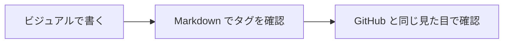

# Vigía へようこそ

これは**サンプル文書**です。自由に書き換えてかまいません。無題のコピーとして開くので、元のファイルが上書きされることはありません。手を加えた版を残したいときは、**名前を付けて保存**で保存してください。

> [!TIP]
> ツール バーの右端にある 3 つのボタン — **ビジュアル · Markdown · GitHub** — を押すか、`⌘1`、`⌘2`、`⌘3` を押してみてください。同じ文書を 3 通りに表示します。読むだけのときは、その隣の**読み取り専用**（`⇧⌘L`）を選べば、誤って変更することはありません。

## 3 つの表示

| 表示 | ショートカット | 見えるもの |
|:--|:--:|:--|
| **ビジュアル** | `⌘1` | 書式付きの文書。入力してボタンを使えば、タグは Vigía が書きます。 |
| **Markdown** | `⌘2` | 左に Markdown テキスト、右にリアルタイムのプレビュー。 |
| **GitHub** | `⌘3` | 読み取り専用: GitHub で表示されるとおりのページ。 |

1. 今はたぶん**ビジュアル**表示です。単語を選んで `⌘B` を押すと、**太字**になります。
2. **Markdown** に切り替えると、同じ単語の両側に `**` が付いています。これがタグです。
3. **GitHub** に切り替えると、下のほうの図と数式が github.com と同じように描かれます。

## テキスト

通常のテキスト、*斜体*、**太字**、~~取り消し線~~、`インライン コード`、[GitHub へのリンク](https://github.com)。名前で書く絵文字 :sparkles: :rocket: や脚注も使えます。[^1]

- 箇条書き
  - 入れ子の項目
- [x] 終わったタスク
- [ ] まだのタスク

> 引用です。Markdown 表示では `>` で始まる行になります。

## コード

```python
def greet(name: str) -> str:
    return f"こんにちは、{name}さん!"
```

## 図 (Mermaid)

ビジュアルと Markdown ではコードとして、GitHub 表示では図として表示されます。



## 数式 (KaTeX)

ランダムなパスワードのエントロピー: $H = L \cdot \log_2 N$

$$
\sum_{k=1}^{n} k = \frac{n(n+1)}{2}
$$

## アラート

> [!NOTE]
> 読む人が知っておくと役に立つ情報。

> [!WARNING]
> 注意が必要なこと。

## フォルダー

**ファイル → フォルダーを開く…** でフォルダーを丸ごと開くと、VS Code や Obsidian のように、その中の Markdown ファイルが左側のツリーに表示されます。フォルダーはいくつでも開けて、その下に開いている文書の目次が表示されます。ファイルをクリックすると開きます。`⇧⌘E` でサイド バーの表示と非表示を切り替えます。

## タブ

ファイルはそれぞれ自分のタブで開きます。`⌘T` で新しいタブを開き、`⌃⇥` でタブを切り替え、`⌘W` でタブを閉じます。**ファイル → 起動時にタブを復元** をオンにすると、次回の起動時に同じファイルが開きます。

---

このサンプルは最初の 1 回だけ自動で開きます。**ヘルプ → サンプル文書** からはいつでも開けます。

[^1]: 脚注です。GitHub 表示ではページの最後に一覧になります。
